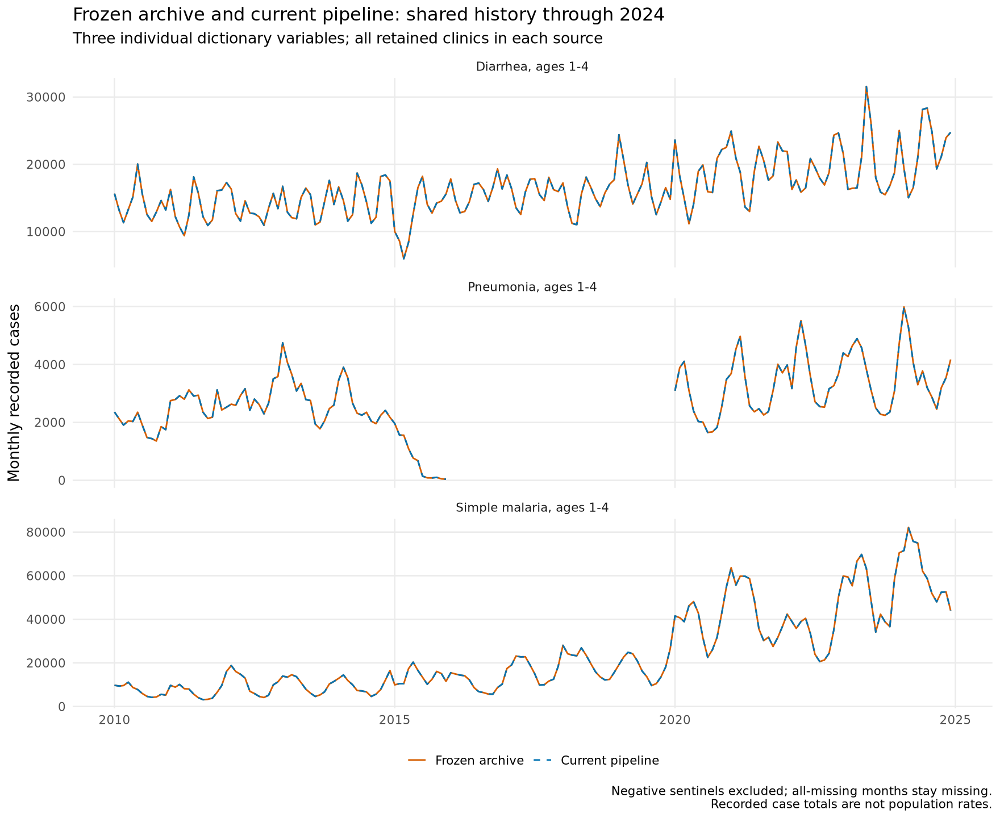
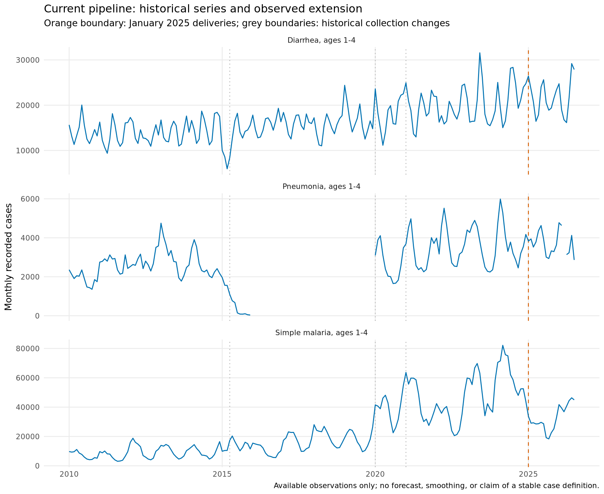
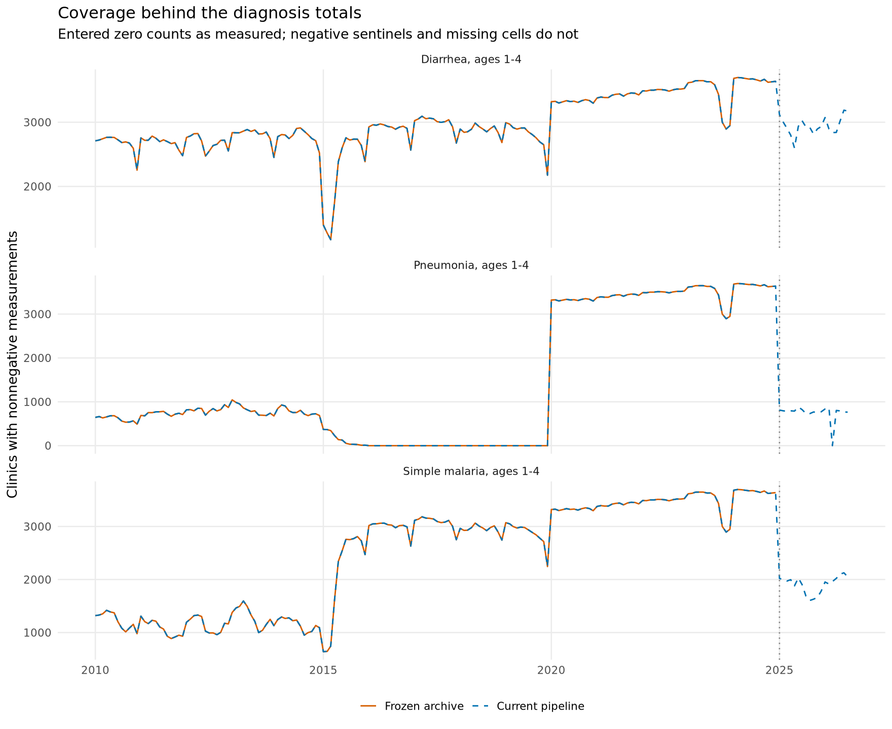

The database brings together monthly clinic reports from Madagascar, with
historical observations from 2010–2024 and a separately ingested 2025–2026
extension. Its three main components are **clinic metadata**, a **diagnosis
dictionary**, and **diagnosis files**. Healthshed polygons provide the spatial
reference for geographic analyses. These are clinic-reported counts, not
individual patient records, population prevalence estimates, or complete
surveillance of every illness in a catchment.

This guide adapts the archived cleaned-database README to the current Parquet
release. The [pipeline map](pipeline/mapping/legacy-pipeline-map.qmd) explains
how the original cleaning stages were reproduced; the remaining Pipeline
pages document their rules and audits.

::: {.manual-prereq title="Start With a Completed Versioned Release"}

First [stage the release directory with Stagecoach](00_access-data.qmd).
Use one complete `v<MAJOR>.<MINOR>.<BUGFIX>/` directory under that symlink,
with its `datapackage.json`, rather than a mixture of files from different
versions or pipeline intermediates. The [release parameters](releases/19_page-package-release.qmd) name and
version the dataset. [The package inventory](releases/22_page-export-frictionless.qmd)
records paths, native column types, row counts, checksums, and spatial encoding.
The default release remains an internal candidate; packaging is distinct from
publication. The figures below describe a saved pipeline snapshot, whose hashes
are recorded separately from a future release.

:::

## Find the data you need

| Release resource | Unit of observation | Use |
| --- | --- | --- |
| `clinic_spatial_metadata.parquet` | One row per `clinic_ID` | Facility attributes, reporting history, coordinates, healthshed availability, neighbor suggestions |
| `clinic_reporting_metadata.parquet` | One row per clinic, year, month | Reporting calendar, source selection, historical database-code provenance and ambiguity |
| `healthsheds2022.parquet` | One row per `fs_uid` | Historical catchment geometry in WKT, with CRS and reference year |
| `diagnosis_dictionary.parquet` | One row per `var` | English/French descriptions, wave-specific source expressions, and diagnosis-file location |
| `by_diagnosis/file*.parquet` | One retained row per clinic, year, month | Harmonized diagnosis variables; `fname` records the selected source family |
| `audits/`, `source_inventory.parquet`, `provenance.parquet`, `review_inputs.parquet` | Varies | Trace source files, reviews, ambiguous codes, numeric parsing, mappings, and source transitions |
| `_contract.parquet`, `manifest.parquet`, `resource_schemas.parquet` | Release resources/fields | Immutable resource selection, independent copy verification, and native schemas |

Intermediate reference tables support curation and investigation. They are not
required for ordinary analysis of a completed release. The current release uses
Parquet throughout; the archive's CSV, Feather, RDS, and shapefile names are
historical references rather than additional files readers must locate.

## Clinic metadata and spatial information

`clinic_ID` links the two metadata tables to diagnosis records. In the spatial
table, `n_month`, `first_report`, and `last_report` summarize retained reporting
history. Region/district information, facility type (`fs_type`), public/private
status (`pub_priv`), and functional status (`f_or_nf`) describe the available
reference information. Associated origin fields retain where attributes came
from; these are not a complete monthly history of facility upgrades or status.

`ID_checked` records historical identity review, principally relevant to the
pre-2020 code reconciliation. It is not a guarantee that every clinic identity
is correct. `clinic_x` and `clinic_y` contain selected longitude and latitude;
`gps_source`, `gps_source_raw`, and `coordinate_status` describe their evidence
and availability. Newly encountered facilities may have missing coordinates.

Join `clinic_spatial_metadata.clinic_ID` to `healthsheds2022.fs_uid` to attach
healthsheds. The current spatial file contains `geometry_wkt`, `crs_wkt`,
`is_empty`, and `reference_year`. It is ordinary Parquet containing WKT, not
GeoParquet. For example, after reading the table as `x`:

```r
geometry <- sf::st_as_sfc(x$geometry_wkt, crs = x$crs_wkt[[1]])
healthsheds <- sf::st_sf(fs_uid = x$fs_uid, geometry = geometry)
```

Healthsheds describe the villages assigned to clinics in the **2022 reference**;
they do not establish a facility's catchment for every year. `has_healthshed`
indicates a nonempty matched polygon. Private clinics, facilities outside the
2022 sectorization, and unmatched villages may lack geometry. The archive's
counts of exceptional clinics were a historical snapshot and should not be
reused as current counts.

For spatial analyses, the archived recommendation was to consider clinics
with a healthshed or a reviewed `neighbor_to_merge`. This remains an analysis
choice, not a filter applied to the released diagnoses. If combining a clinic
with its suggested neighbor, document the pair and sum each clinic once; do
not duplicate the neighbor's existing totals. Inspect missing geometry and
`healthshed_temporal_status` before extending a spatial analysis into 2025–2026.

The reporting table uses `year` and `month`; diagnosis files use `cAnnee` and
`cPeriode`. `fname` is a source-family identifier, not a diagnosis variable:

| `fname` | Nominal source period |
| --- | --- |
| 1 | 2010–March 2015 |
| 2 | April 2015–2016 |
| 3 | 2017 |
| 4 | 2018 |
| 5 | 2019 |
| 6 | DHIS2 from 2020 onward, including the new deliveries |
| 0 | No retained report in the reporting calendar |

Historical source selection can retain a report from another source family
when the expected file has no report; `fname` records what was actually used.
`clinic_database_code` retains the source identifier for a clinic-month.
When several historical candidates cannot be resolved, the current pipeline
keeps one reporting row, leaves that code missing, sets
`database_code_ambiguous`, and preserves candidates in
`audits/reporting_code_candidates.parquet`.

The extension also records `source_report_present` and `source_covered`.
An absent clinic report and a month absent from the supplied source coverage
are different situations. A calendar row with `fname = 0` is not an observed
zero for every disease.

## Diagnosis dictionary

Each `var` identifies a harmonized variable. `description_en` and
`description_fr` describe it; `filename` locates its diagnosis partition.
`wave1_colname`, `wave2_colname`, `wave3A_colname`, and `wave3B_colname`
record the source expressions. `waves_available` and the Wave 3 descriptions
help interpret coverage and construction. Consult the expressions as well as
the short English label: a variable can have different components in different
collection eras, or be unavailable in an entire wave.

The dictionary retains both broader harmonized categories and finer
categories available in only some waves. **Variables can overlap.** Adding
every diarrhea or pneumonia search result can double-count cases; referrals
can also be a subset of other age/sex totals. `V` identifiers and `file1`–`file40`
partition names are identifiers, not a clinical taxonomy or a recommendation
to combine adjacent columns.

For example, `V121` is the dictionary's diarrhea category for ages 1–4 and is
constructed from different source components across waves. `V135` is pneumonia
for ages 1–4 and has no Wave 2 expression. Its missing 2015–2019 segment in the
figures is an unavailable definition, not evidence of zero pneumonia.

## Diagnosis files and interpretation

Each diagnosis partition contains `clinic_ID`, `cAnnee`, `cPeriode`, `fname`,
and its assigned `V` columns. Retained partitions share a common clinic-month
key set; wrong-source alternatives remain curation evidence rather than extra
observations to append to the released diagnoses. Cleaning reconciles clinic
identifiers, reduces repeated reports, chooses source families, and applies
the dictionary's wave-specific expressions.

Keep these distinctions when analyzing the measurements:

- **Entered zero:** an observed count of zero.
- **Missing value:** unavailable or unreported information; do not replace all
  missing values with zero. All-missing sums in the new extension remain missing.
- **Historical `-1`:** a blank/sentinel in older data. Its handling depends on
  the variable construction; it is not a negative disease count.
- **Other negative sentinels, including `-99`:** retained cleaning/ambiguity
  evidence requiring investigation before analysis.

Historical clinic IDs attempt to follow facilities through GESIS code changes
and the switch to DHIS2 UIDs. Large name changes, reused codes, and incomplete
review can still affect linkage. New-source identity decisions and candidate
predecessors are retained in the release's audits.

Collection transitions occurred around April 2015, January 2020, and January
2021. The additional 2025 deliveries introduce another source boundary and
mid-2025 renaming changes. A jump in counts can reflect definitions, reporting
coverage, source formatting, or epidemiology; the graph alone cannot identify
the cause. The archive specifically cautioned about trauma, pneumonia,
measles/meningitis notification categories, and malnutrition definitions.
Its interpretation of tetanus trends is a historical hypothesis rather than
a conclusion established by this migration. Birth variables refer to births
recorded within clinics, and trauma categories refer to physical trauma, as
described in the archived README; consult individual definitions before use.

## Historical comparison and the continuing series

The reference is the **most recent archived data within the hand-delivered May
2025 ZIP**, specifically `data/clean/by_diagnosis_2024/file2.feather`, rather
than a later Drive copy. The archive and dictionary are checked against the
[reviewed baseline](pipeline/mapping/legacy-pipeline-map.qmd#most-recent-archived-data-comparison-baseline).
The three examples are the dictionary variables `V114` (simple malaria), `V121`
(diarrhea), and `V135` (pneumonia), each for ages 1–4. They are individual
variables, not sums of overlapping search results.

Their archived and current English labels and source descriptions match.
`V121` has different internal Wave 3B `X` identifiers in the two dictionaries;
the comparison preserves this fact rather than assuming equal `V` labels alone
establish semantic equivalence. Full dictionary and all-variable measurement
equivalence remain separate investigations.

{#fig-archive-comparison}

The totals sum nonnegative values across retained clinics in each source.
Negative sentinel cells are excluded and all-missing months remain missing.
There is no smoothing, interpolation of missing months, or conversion to
population rates. Matching national totals would not by themselves establish
agreement at individual clinics, so the diagnostic also aligns unique
`clinic_ID`/year/month keys and compares the original cells, including missing
values and sentinels. The evidence snapshot below reports that stricter check.

**Measured snapshot, 10 November 2026:** all three variables match exactly on
all **550,845 shared historical clinic-months**. This is **1,652,535 equal
cells and zero unequal cells**, treating paired missing values as equal and
preserving sentinel distinctions. The selected `fname` also agrees at every
shared key.

| Historical coverage through 2024 | Clinic-months |
| --- | ---: |
| Present in both sources | 550,845 |
| Present only in the archive | 39 |
| Present only in the current pipeline | 90 |

The unmatched rows remain explicit coverage differences; their causes have
not been established by this diagnostic. Consequently, this is strong measured
agreement for the three examples on shared observations, **not complete
archive equivalence**. The monthly plots include each source's own retained
population rather than silently discarding unmatched rows.

{#fig-trend-extension}

The observed extension ends in **July 2026** in this snapshot. The continuation
contains newly ingested observations, not an extrapolation
of the archive. It retains the same dictionary interface while the ingestion
handles new headers, repeated deliveries, identity decisions, and missingness.
The [source-seam audits](pipeline/30_page-validate-migration.qmd) compare
December 2024/January 2025 and May/June 2025 against corresponding earlier-year
transitions. Their flags identify questions for review, not proof that a trend
is epidemiological or permission to change a diagnosis mapping.

{#fig-reporting-coverage}

Interpret the counts together with this coverage figure. A clinic with an
entered zero contributes to coverage; a missing or negative cell does not.
Changes in contributing facilities can alter totals without the same change in
within-clinic disease burden. The extension may also end in an incomplete
calendar year; compare equivalent months before comparing annual totals.

In these examples, measurement coverage drops at the start of the 2025
deliveries, particularly for malaria and pneumonia. The post-2024 series is a
continuation of the data product, but it is not evidence of seamless reporting
coverage. Treat an apparent level change across that boundary as a question to
investigate, rather than interpreting it directly as a change in illness.

::: {.manual-procedure title="Load a Diagnosis of Interest From a Release"}

Search the dictionary, inspect the definitions, and deliberately choose the
variables required for the analysis. This example selects one pneumonia
variable and reads only its key fields and measurement from 2020 onward:

```r
# Run from your analysis project after staging with Stagecoach.
# Replace v0.1.0 with the complete version selected for your analysis.
release <- "data/inputs/01_gold_mine/mdg_healthshed_clinic_data/releases/v0.1.0"
package <- frictionless::read_package(file.path(release, "datapackage.json"))
dictionary <- duckplyr::read_parquet_duckdb(
  file.path(release, "diagnosis_dictionary.parquet"), prudence = "stingy"
) |> dplyr::collect()

hits <- dictionary |>
  dplyr::filter(grepl("pneumonia", description_en, ignore.case = TRUE))
hits |> dplyr::select(var, description_en, waves_available, filename)

wanted <- hits |> dplyr::filter(var == "V135")
stopifnot(nrow(wanted) == 1L)
pneumonia <- duckplyr::read_parquet_duckdb(
  file.path(release, "by_diagnosis", paste0(wanted$filename, ".parquet")),
  prudence = "stingy"
) |>
  dplyr::filter(cAnnee >= 2020L) |>
  dplyr::select(clinic_ID, cAnnee, cPeriode, fname, dplyr::all_of(wanted$var)) |>
  dplyr::collect()
```

Keep year/month filters and column selection before `collect()` to limit
memory use. To attach reporting metadata, match `clinic_ID`, `cAnnee = year`,
and `cPeriode = month`; attach spatial attributes by `clinic_ID`. Check join
cardinality before interpreting totals. Frictionless inventories the package;
DuckDB reads the Parquet and sf reconstructs WKT geometry.

:::

::: {.manual-check title="Check the Scope of an Agreement Claim"}

Three example series can demonstrate agreement or identify discrepancies in
those series. They cannot certify all variables, every identity link, or the
scientific interpretation of a temporal change. Complete schema/key validation,
byte-identical release-copy checks, selected-cell comparisons, and full
scientific equivalence answer different questions.

Before analysis, confirm the selected release version, inspect variable
definitions, check join cardinality, and account for reporting coverage and
missingness. Record those choices with the analysis. Operators can use
[Evidence maintenance](04_misc-data-guide-evidence.qmd) to reproduce and test
the comparison snapshot.

:::
